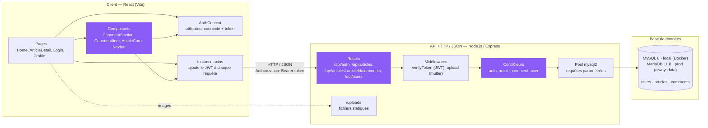
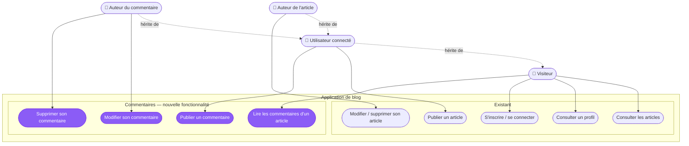
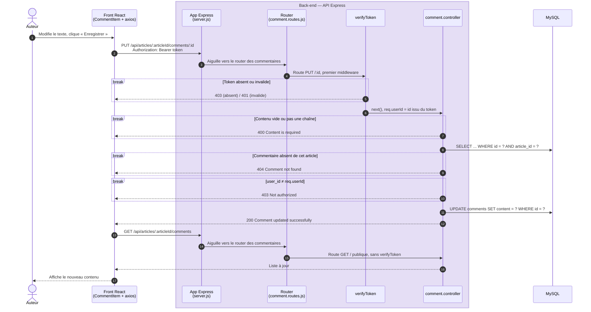

# Modélisation de l'application

Ce document décrit l'application de blog sous trois angles complémentaires :

1. **Architecture** : comment l'application est construite.
2. **Cas d'utilisation** : qui peut faire quoi.
3. **Séquence « modifier un commentaire »** : comment une action est sécurisée de bout en bout.

---

## 1. Architecture

L'application suit une architecture **trois tiers** : un client React, une API REST Express et une base MySQL. Côté API, chaque requête traverse les mêmes couches : **routes → middlewares → contrôleurs → base de données**.

| Couche | Rôle | Point de sécurité |
|---|---|---|
| **AuthContext + axios** | Garde l'utilisateur connecté et ajoute automatiquement le token JWT aux requêtes. | Le front ne décide de rien : il n'affiche les boutons que pour l'auteur, mais c'est l'API qui autorise. |
| **Routes** | Associent une URL et une méthode HTTP à un contrôleur. Les commentaires sont imbriqués sous leur article (`mergeParams`). | Les routes d'écriture (POST, PUT, DELETE) passent toutes par `verifyToken`. |
| **Middlewares** | `verifyToken` vérifie le JWT et place l'id de l'utilisateur dans `req.userId`. | L'identité vient du token signé, jamais de ce qu'envoie le client. |
| **Contrôleurs** | Valident les données, vérifient les droits, puis interrogent la base. | Validation du contenu (400), existence (404), auteur (403). |
| **Pool mysql2** | Exécute les requêtes SQL. | Toutes les requêtes sont paramétrées (`?`), ce qui protège contre l'injection SQL. |
| **MySQL** | Stocke les données. | Clés étrangères avec `ON DELETE CASCADE` : supprimer un article ou un utilisateur supprime ses commentaires. |

En violet : les éléments ajoutés ou modifiés pour la fonctionnalité commentaires.

---

## 2. Cas d'utilisation

Quatre acteurs. Les deux auteurs héritent des droits de l'utilisateur connecté, qui hérite lui-même de ceux du visiteur :

- **Visiteur** : n'importe qui, sans compte.
- **Utilisateur connecté** : a un compte et un token JWT valide.
- **Auteur de l'article** : l'utilisateur connecté qui a publié un article donné.
- **Auteur du commentaire** : l'utilisateur connecté qui a écrit un commentaire donné.

| Cas d'utilisation | Acteur minimum | Contrôle côté API |
|---|---|---|
| Modifier / supprimer son article | Auteur de l'article | `verifyToken`, article existant, `user_id` = utilisateur connecté. |
| Lire les commentaires | Visiteur | Aucun, la route est publique. |
| Publier un commentaire | Utilisateur connecté | `verifyToken`, contenu non vide, article existant. |
| Modifier son commentaire | Auteur | `verifyToken`, contenu non vide, commentaire existant sur cet article, `user_id` = utilisateur connecté. |
| Supprimer son commentaire | Auteur | `verifyToken`, commentaire existant sur cet article, `user_id` = utilisateur connecté. |

---

## 3. Séquence : modifier un commentaire

C'est l'action la plus contrôlée de la fonctionnalité. Chaque bloc `break` est un **garde-fou** : si sa condition est vraie, la requête s'arrête là avec le code HTTP indiqué. Sinon, on passe au contrôle suivant.

- **Un `break` = un `return` dans le code** : les blocs suivent exactement l'ordre des vérifications du contrôleur, qui s'arrête au premier contrôle qui échoue.
- Le front masque les boutons aux non-auteurs, mais l'API revérifie tout. Un appel direct à l'API (Postman, curl) sans être l'auteur reçoit un 403.
- La suppression suit la même séquence, sans l'étape de validation du contenu.

> **Note sur les codes 401 et 403 (choix hérité du projet)**
>
> Le middleware `verifyToken` existant renvoie **403** quand le token est **absent**, et **401** quand il est **invalide ou expiré**. La convention HTTP (RFC 9110) distingue plutôt :
>
> - **401 Unauthorized** : la requête n'est pas authentifiée (token absent, invalide ou expiré) ;
> - **403 Forbidden** : l'utilisateur est authentifié, mais n'a pas le droit d'agir sur cette ressource.
>
> Dans une version conforme, le token absent renverrait donc 401. Le 403 resterait réservé au cas « l'utilisateur connecté n'est pas l'auteur du commentaire », que le contrôleur des commentaires gère déjà correctement. Ce comportement du middleware a été conservé tel quel, car il ne fait pas partie du périmètre de la fonctionnalité commentaires.
