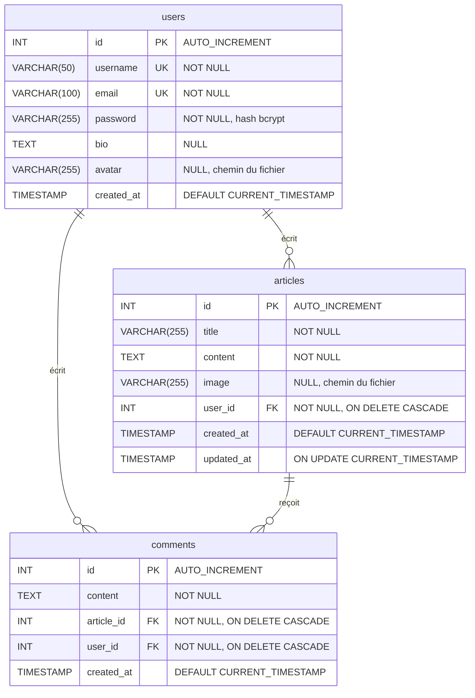

# Schéma de la base de données

Base composée de trois tables : **MySQL 8** en local (`blog_db`, conteneur Docker) et **MariaDB 11.8** en production (hébergée sur alwaysdata). Le schéma est identique et compatible avec les deux moteurs. La table comments est celle ajoutée pour la fonctionnalité : chaque commentaire est rattaché à son auteur (user_id) et à l'article commenté (article_id).

Les tables sont créées au démarrage de l'API, dans [`server/config/db.js`](../server/config/db.js) (`CREATE TABLE IF NOT EXISTS`).

**Lecture des relations** (notation « patte de corbeau ») :

- Un **utilisateur** écrit **0 à n articles** et **0 à n commentaires**.
- Un **article** reçoit **0 à n commentaires**.
- Un commentaire appartient à **exactement un** article et **exactement un** auteur : ses deux clés étrangères sont `NOT NULL`.
